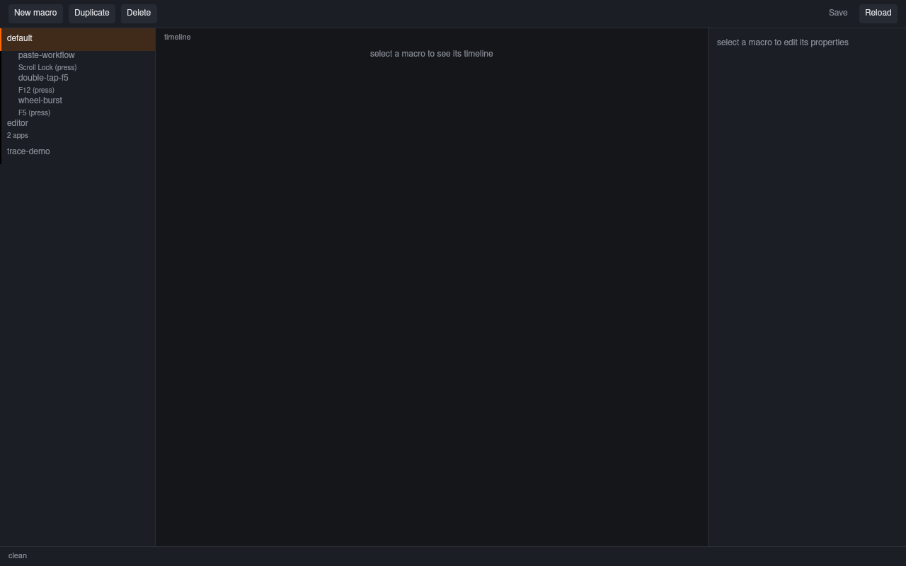
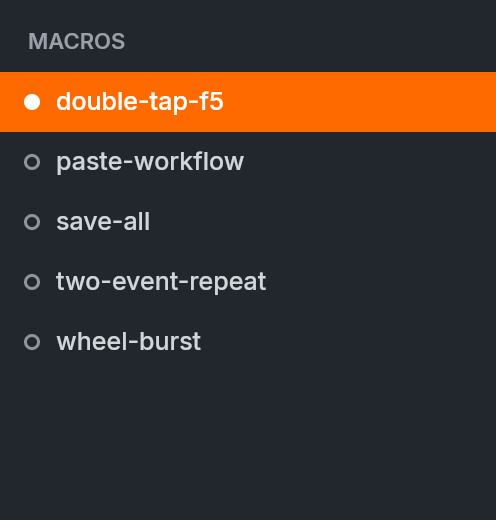

# macro-daemon



A vendor-neutral macro daemon for Linux. It replays macro semantics recovered from a commercial peripheral suite. Those are the event schema, the pacing model, the repeat rules, and the HID key-code space. Triggers come from `evdev`. Injection goes through `uinput`. The original engine is onboard-only. Every play ends in a firmware deploy, and the shipped product has no input-injection API at all. See `MACRO_SPEC.md` §B.5. This is not a port of their runtime. It is a reimplementation of their data model and timing, with the device replaced by a virtual one. The notes are in [DESIGN.md](DESIGN.md). The editor is a Rune app in the SteelSeries Macro Editor style. The engine can hold a key for 400 ms. `macro-mcp` authors that hold over stdio.

## The editor

`macro-studio` is the Rune editor. The window title is `Macro Editor`. It is a separate workspace member. The `macro_daemon` config types are the single source of truth, so a file it saves is a file the daemon reads.

The shot above is a headless render of the shipped `profiles/` directory. **double-tap-f5** is selected. The selected row is orange. The black chip in the strip reads **120 ms**. **+ NEW** sits at the bottom of the rail.



The rail is a list of radios and names, flattened across profile files and sorted by name. The other rows are **paste-workflow**, **save-all**, **two-event-repeat**, and **wheel-burst**.


The center is the macro name, then one strip of chips. A key chip is teal. A delay chip is black and shows its milliseconds. The rest of the canvas is empty.


The circle button prints the profiles directory. **CLEAR** empties the selected macro's events. **START** plays that macro through `MockInjector` and reports the plan. The red circle is record. It does not write events. This build has no keyboard capture. **REVERT** is dim here because the workspace is clean. **SAVE** is orange.

**SAVE** validates before writing. A file the daemon would reject is never written. **REVERT** re-reads the directory and discards unsaved edits, the same semantics as sending the daemon `SIGHUP`.

```bash
cargo build --workspace          # builds macro-daemon, macro-mcp, and macro-studio
cargo run -p macro-studio        # opens ./profiles
cargo run -p macro-studio -- ~/my-profiles
cargo run -p macro-studio -- --validate profiles   # parse + validate + round-trip, then exit
VK_ICD_FILENAMES=/usr/share/vulkan/icd.d/lvp_icd.json \
  cargo run -p macro-studio --release -- --snap app/screenshots/main-window.png --scene delay --size 1080x640 --scale 2 profiles
```

Cold-start numbers for this machine are in [docs/ui-cold-start.md](docs/ui-cold-start.md).

## MCP

`macro-mcp` is a stdio server. The command is the release binary `macro-mcp`. It takes no arguments. From this repo that file is `target/release/macro-mcp`. Capy runs a literal command, with no shell.

An agent can resolve a key name, write a hold timing, and validate the profile through the daemon's existing types. It does not inject keys. It does not rewrite the daemon.

Numpad 4 holds E for 400 ms.

The tools are `resolve_key`, `bind_hold`, `validate`, and `hold_proof`. `hold_proof` reports an engine-level hold. It does not open `/dev/uinput`.

## Hold timing

The proof is in [docs/e2e-timing.md](docs/e2e-timing.md). The harness authors a macro of press, 400 ms delay, release, plays it through the real `Runner::execute` path, and measures the wall-clock gap between the press and the release at the injection boundary.

This table is from one release run on this machine, 2026-11-17. It is engine-level. The injector is `MockInjector` behind a timestamping wrapper. `/dev/uinput` is absent here, so this is not a device-level number. The doc shows how to run the device probe on a machine that has the node.

```
./target/release/macro-e2e --hold-ms 400 --iters 30

engine-level hold timing, target 400 ms (tolerance 10 ms on the median)
iterations: 30

      stat     hold_ms
       min     400.077
    median     400.103
       p95     400.128
       max     400.135

pass: yes (|median - 400| = 0.103 ms)
```

The same binary is what `cargo run -p macro-e2e --release -- --hold-ms 400 --iters 30` runs. The median is 0.103 ms above 400, inside the 10 ms pass line. [docs/e2e-timing.md](docs/e2e-timing.md) explains that overshoot.

## Behavior

- **Recovered pacing.** Timestamp offsets and `type:4` delay events replay exactly as recorded. `jitter_ms` exists because a user may want it and ships at 0. The recovered format has no jitter field, and adding randomness makes replay less faithful.
- **Per-app profiles.** Profile selection follows the focused window's executable path, never a window title. Focus comes from `hyprctl`, `swaymsg`, `xdotool`, or `xprop`, tried in that order.
- **Hot-reload.** `SIGHUP` re-reads the profiles directory and swaps it in atomically. A parse error logs and keeps the previous set. The daemon does not exit on a bad edit.
- **Self-exclusion.** The daemon's own virtual device is excluded from trigger discovery, so a macro that emits its own trigger key cannot retrigger itself.
- **Tested without hardware.** 62 tests in the daemon package, including `macro-mcp`, run with no root and no input devices, so CI runs the suite anywhere. `cargo test --workspace` runs all 94.

## Build and install

```bash
cargo build --release          # target/release/macro-daemon, macro-mcp, and macro-studio
cargo test                     # 62 daemon-package tests, including macro-mcp, no root, no devices
```

Rust 1.75 or newer. Daemon dependencies are `evdev`, `uinput`, `serde`, `serde_json`, `clap`, `anyhow`, `tracing`, `tracing-subscriber`, and `signal-hook`. The `macro-studio` app adds Rune. A windowed run on Linux needs `libxkbcommon-x11-0`. A headless `--snap` run needs a Vulkan driver. On a machine with no GPU, install `mesa-vulkan-drivers` and point `VK_ICD_FILENAMES` at lavapipe. No network calls at run time. The Rune git pin is fetched at build time.

The daemon needs write on `/dev/uinput` and read on `/dev/input/event*`.

```bash
# 1. uinput module
sudo modprobe uinput
echo uinput | sudo tee /etc/modules-load.d/uinput.conf    # persist

# 2. permissions
sudo usermod -aG input "$USER"                            # then log out and back in
sudo install -m 644 packaging/60-macro-daemon.rules /etc/udev/rules.d/
sudo udevadm control --reload-rules && sudo udevadm trigger
```

If `/dev/uinput` is missing or unwritable the daemon says so and names the fix. It does not panic.

```
Error: /dev/uinput does not exist.
  Load the module:        sudo modprobe uinput
  Persist it:             echo uinput | sudo tee /etc/modules-load.d/uinput.conf
  Then re-run; if it still fails the node is root-only — install the udev rule from README.
```

## Run

```bash
macro-daemon                       # uses ./daemon.json if present
macro-daemon --config /etc/macro-daemon/daemon.json
macro-daemon --list-devices        # what can be read
macro-daemon --validate            # parse configs, print bindings and both playback numberings
macro-daemon --trace default:m-f5x2   # timed trace of one macro, exits
macro-daemon --dry-run             # real triggers, logged injections, no /dev/uinput writes
```

`SIGINT` and `SIGTERM` shut down cleanly. An optional hotkey in `daemon.json`, `"toggle_hotkey": "KEY_F11"`, suspends and resumes the daemon without stopping it. The event is swallowed and never reaches the macro engine.

## Configuration

Two layers. A daemon config, and a directory of profiles.

### `daemon.json`

```json
{
  "devices": [],
  "profiles_dir": "profiles",
  "default_profile": "default",
  "jitter_ms": 0,
  "toggle_hotkey": "KEY_F11",
  "focus_poll_ms": 500,
  "debounce_ms": 5,
  "grab": false
}
```

| field | meaning |
|---|---|
| `devices` | evdev nodes to read. Empty means autodiscover readable keyboards. The daemon's own virtual device is always excluded. Otherwise an F5-emitting macro bound to F5 would retrigger itself. |
| `profiles_dir` | directory of `*.json` profiles |
| `default_profile` | profile used when no per-app rule matches |
| `jitter_ms` | uniform ±ms around every delay. **0 means off**, which is the faithful setting. The recovered format has no jitter field. See `MACRO_SPEC.md` §A.4. |
| `toggle_hotkey` | `KEY_*` name from `keymap.json`, or a numeric evdev code |
| `focus_poll_ms` | focus poll interval for per-app rules |
| `debounce_ms` | per-binding re-trigger guard |
| `grab` | `EVIOCGRAB` the trigger devices. They stop reaching the rest of the system. Refused at startup when any binding sets `is_passthrough`, because then the key cannot reach the application. |

### `profiles/<name>.json`

Field names are the recovered ones, so a config can be diffed against real engine data. `macros[].events[]` is `{type, page, code, extraData, timestamp}`. `bindings[].trigger_data` is `{hidCode, page, type, direction}`. `bindings[].playback_options_data` is `{type, num_repeat, repeat_delay}`.

```json
{
  "version": 1,
  "profile": { "name": "default", "apps": [] },
  "macros": [
    {
      "id": "m-repeat-demo",
      "name": "two-event-repeat",
      "events": [
        { "type": 2, "page": 1, "code": 4,  "extraData": 1, "timestamp": 0 },
        { "type": 2, "page": 1, "code": 4,  "extraData": 0, "timestamp": 0 }
      ]
    }
  ],
  "bindings": [
    {
      "type": "customAction",
      "macro_id": "m-repeat-demo",
      "trigger_data": { "hidCode": 66, "page": 1, "type": 2, "direction": 1 },
      "playback_options_data": { "type": 1, "num_repeat": 3, "repeat_delay": 50 }
    }
  ]
}
```

Worked example. `ctrl+shift+v`, once, bound to F9.

`hidCode` 56 is F9, HID usage `0x38`. Modifiers are `0xE0` and `0xE1`. `V` is `0x19`.

```json
{
  "version": 1,
  "profile": { "name": "work", "apps": ["/usr/bin/code", "code"] },
  "macros": [{
    "id": "m-paste-plain",
    "name": "paste-plain",
    "events": [
      { "type": 2, "page": 1, "code": 224, "extraData": 1, "timestamp": 0 },
      { "type": 2, "page": 1, "code": 225, "extraData": 1, "timestamp": 0 },
      { "type": 2, "page": 1, "code": 25,  "extraData": 1, "timestamp": 0 },
      { "type": 2, "page": 1, "code": 25,  "extraData": 0, "timestamp": 0 },
      { "type": 2, "page": 1, "code": 225, "extraData": 0, "timestamp": 0 },
      { "type": 2, "page": 1, "code": 224, "extraData": 0, "timestamp": 0 }
    ]
  }],
  "bindings": [{
    "type": "customAction",
    "macro_id": "m-paste-plain",
    "trigger_data": { "hidCode": 56, "page": 1, "type": 2, "direction": 1 },
    "playback_options_data": { "type": 0, "num_repeat": 1, "repeat_delay": 15 }
  }]
}
```

`apps` entries are matched against the focused process's executable path, exact or basename equality, never a window title. That is what the original does with `applications.path`, `MACRO_SPEC.md` §D.4. If no focus source is available the daemon logs once and stays on the current profile.

### Playback types

`playback_options_data.type` on disk uses the client numbering. An onboard macro header uses the wire numbering. They differ by one. Mixing them is the silent bug. `type: 1` means play once in one table and repeat N times in the other.

| mode | client, config and DB | wire, firmware |
|---|---|---|
| playOnce | 0 | 1 |
| repeatNTimes | 1 | 2 |
| repeatWhilePressed | 2 | 3 |
| toggleRepeat | 3 | 4 |
| toggleHold | 4 | 5 |
| holdWhilePressed | no client slot | 6 |

Both are modelled by one `#[repr(u8)]` enum whose discriminants are the wire values, with `from_client`, `to_client`, `from_wire`, and `to_wire`. Unknown values are hard errors. Nothing is coerced. `--validate` prints both numbers per binding so a mismatch is visible.

## Testing

`cargo test` runs 62 tests in the daemon package, including `macro-mcp`, with no root and no devices. The regression suite pins bugs found by running the daemon, not by reading the spec.

- `hotkey_is_matched_in_hid_space_not_evdev_space`. The toggle hotkey resolves in HID usage space, like every other key reference.
- `synthetic_devices_are_recognised_by_name`. `ydotoold`, `wtype`, and the daemon's own virtual device are excluded from autodiscovery, so injected output cannot feed back in as input.
- `locked_injector_does_not_hold_the_device_across_a_macro`. The device lock releases between macros, so a long macro cannot block the next one.
- `gate_key_survives_a_profile_switch`. The toggle hotkey still resolves after a profile swap.

The harness package carries 9 more tests and the studio 23. `cargo test --workspace` runs all 94. The hold-timing command and this machine's table are in [Hold timing](#hold-timing).

## Compatibility

Comments in the source cite `MACRO_SPEC.md §X`. That file is the behavioural spec this was written against. It is not part of this repository. Every citation names the rule being implemented.

| `MACRO_SPEC.md` behaviour | implementation |
|---|---|
| §A.1 `macros` row, id, name, events, recordingOptions, is_deleted, is_new | `config::Macro` |
| §A.2 event object `{type,page,code,extraData,timestamp}` | `config::MacroEvent`, `config::EventType` |
| §A.2 `{"events": …}` column framing | `config::Macro::db_events_string`, `from_db_events_string` |
| §A.2 event to input mapping, including 255 ≡ −1 | `engine::Runner::run_once`, `engine::signed_tiny` |
| §A.4 `playback_options_data` and dual numbering | `config::PlaybackOptions`, `config::PlaybackType` |
| §A.5 `recording_options {timeout}` | `config::RecordingOptions` |
| §B.4 pacing, timestamp offsets, `type:4` delays | `engine::plan_offsets` |
| §B.4 repeat table, `num_repeat` and `repeat_delay` placement | `engine::Runner::execute` |
| §B.5 software injection, the gap the original has | `inject::UinputInjector` |
| §C.1 and §C.3 HID usage to evdev, no guessing | `keymap::Keymap`, `keymap::Keymap::resolve` |
| §C.3 unknown usage, log and skip | `engine::Runner::warn_missing` |
| §D.1 `bindings` row | `config::Binding` |
| §D.2 `trigger_data` | `config::TriggerData`, `trigger::InputSample::matches` |
| §D.3 binding types and transparent macros | `config::binding_types`, `main::daemon` |
| §D.4 per-app profile by executable path | `config::ProfileSet::select_for`, `apprule::FocusWatcher` |
| §B.3 onboard blob authoring | not implemented, out of scope |

## Spec gaps

Each item is a `TODO`-style comment in code, with the spec reference.

1. **§E.3 timestamp origin.** `engine::plan_offsets`. Absolute-from-start reading. It degrades to sequential order when all timestamps are 0, which is what the editor emits.
2. **§A.2 wheel and tilt values other than 1 and 255.** `engine::signed_tiny`. Values under 128 are positive, otherwise −1.
3. **§E.5 consumer page table.** `keymap::consumer_usage_to_evdev`. Rebuilt from the public HID consumer page. The original's numeric list lives in encrypted device descriptors.
4. **§B.1 text and OS macro expansion.** `main::daemon`. `text_macro` and `osMacroAction` bindings log a warning instead of silently doing nothing. Converting text to HID events needs a keyboard layout model that the spec does not describe.
5. **§B.4 `holdWhilePressed` and hold semantics.** `engine::Runner::execute` treats `holdWhilePressed` as a held-mode loop, the conservative reading of the one-line description.

## Troubleshooting

| symptom | cause |
|---|---|
| `no readable input devices` | not in the `input` group, or the udev rule is not applied |
| `per-application rules disabled` | no `hyprctl`, `swaymsg`, `xdotool`, or `xprop` on `PATH` |
| macro fires its own output | the daemon excludes its own device and other synthetic keyboards, `ydotoold`, `wtype`, and a name containing `uinput`, during autodiscovery. An explicit `-d` path skips that filter, so do not point it at a virtual node |
| nothing happens on Wayland with `grab: true` | grabbing removes the device from the compositor. Use `grab: false` unless you want that |

## License

MIT. See [LICENSE](LICENSE).
